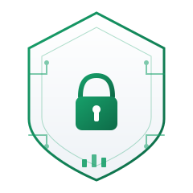

<div align="center">



# ⚡ SERVNIX ⚡

### Self-hosted Linux server security dashboard — real firewall, real scans, real data

**Kein Kundenservice. Kein Support-Bullshit. Nur Code, der wirklich läuft.**

[](LICENSE)
[](#-installation--setup)
[](#-installation--setup)
[](https://github.com/nick-rift/Servnix/stargazers)

[](https://www.tiktok.com/@nick.rift)
[](https://www.instagram.com/nick.rift)


</div>

---

## ⚡ In 30 Sekunden

```bash
git clone https://github.com/nick-rift/Servnix.git && cd Servnix
./scripts/install-dependencies.sh && cp .env.example .env
npm install && npm start
```

Dashboard läuft danach auf `http://127.0.0.1:3000` – **nur lokal**, Zugriff per SSH-Tunnel. Ausführlich: [Installation & Setup](#-installation--setup).

---

## 📖 Inhalt

| | |
|---|---|
| [🎯 Was ist Servnix wirklich?](#-was-ist-servnix-wirklich) | Der ehrliche Überblick |
| [⚡ Was tatsächlich funktioniert](#-was-tatsächlich-funktioniert) | Jeder Check und das Werkzeug dahinter |
| [🧱 Die Servnix-Firewall](#-die-servnix-firewall-eigenständig-ohne-opnsense) | nftables, Default-Deny, Rate-Limiting |
| [🛡️ Servnix Guard](#️-servnix-guard--automatische-angriffserkennung--ip-sperrung) | Automatische IP-Sperrung |
| [🌐 Website-Schutz](#-website-schutz-webserverwebanwendungen-härten) | Web-Scan und Angriffserkennung |
| [🔐 Dashboard-Härtung](#-dashboard-härtung-schutz-der-app-selbst) | Die App schützt sich selbst |
| [🔗 OPNsense-Anbindung](#-opnsense-anbindung-optional) | Optional, per REST-API |
| [🚀 Installation & Setup](#-installation--setup) | Schritt für Schritt |
| [📋 API-Endpunkte](#-api-endpunkte) | Vollständige Referenz |

---
